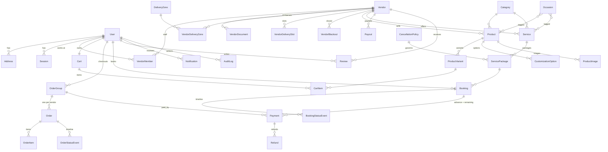

# Data model

Source of truth: [`packages/db/prisma/schema.prisma`](../../packages/db/prisma/schema.prisma) (36 models, migration `init` applied on Postgres 16). Conventions are at the top of that file: integer paisa, basis points, UTC, `name`/`nameUr`, `isDemo`, snapshots on orders/bookings.

## Key decisions

| Decision | Why |
|---|---|
| Multi-vendor cart → one `OrderGroup`, one `Order` per vendor | One payment for the customer; each vendor manages and is paid for only its own order |
| Product orders and bookings are separate tables, separate state machines | The brief requires two systems; their lifecycles differ (delivery vs event, single vs advance/remaining payments) |
| Snapshots (`productTitle`, `unitPricePaisa`, `addressSnapshot`, `policySnapshot`) | Editing a listing or policy must never change a past order or booking |
| Delivery charges/zones/slots are vendor rows | RUNG never invents prices or availability |
| `Payment.isSandbox` defaults true; `idempotencyKey` unique | Safe retries; nothing is treated as real money until Milestone 8 with real merchant accounts |
| KYC files stored as private bucket keys | CNIC images are sensitive; served only through signed URLs |
| `Int` paisa (≤ Rs 21.4M per row) | Enough for any single order/booking; aggregates summed in BigInt in code |
| Roles array on User + VendorMember table | A person can be customer and vendor staff with one phone number |
