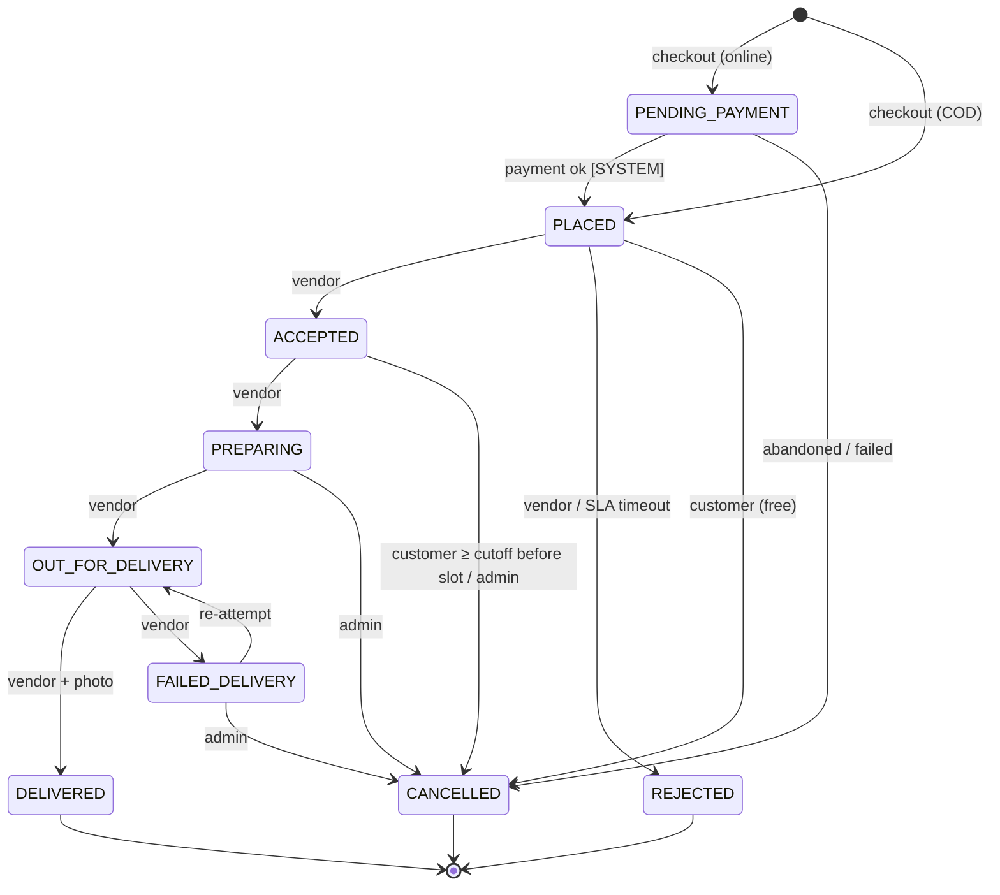
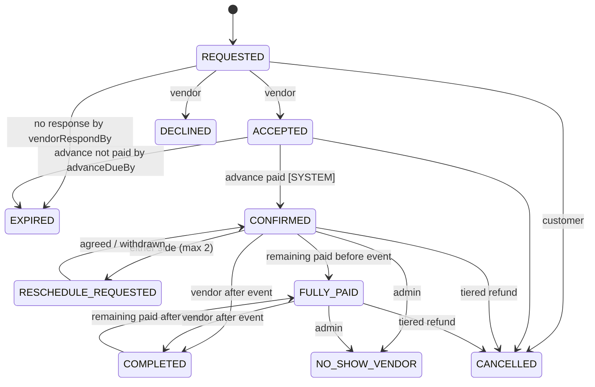

# Order and booking state machines

Implemented in `packages/domain/src/order-state.ts` and `booking-state.ts`; covered by `packages/domain/test/domain.test.ts` (which also checks the enums match `schema.prisma`). Every transition writes an `OrderStatusEvent` / `BookingStatusEvent` with actor and note.

## Product order

Side effects: stock reserved on PLACED, released on CANCELLED/REJECTED; prepaid CANCELLED/REJECTED → Refund(REQUESTED); DELIVERED → eligible for payout + review.

## Service booking

A booking is "closed" when it is COMPLETED **and** paidPaisa ≥ totalPaisa.

**Refund rule:** customer cancellation uses the policy tiers frozen in `policySnapshot` (first tier whose `hoursBefore` is met). Vendor/admin cancellation and NO_SHOW_VENDOR refund 100% of what was paid.
